## Hi there , i'm Muhammad Rafi Ramadhan👋

<!--
**mrafi-dev/mrafi-dev** is a ✨ _special_ ✨ repository because its `README.md` (this file) appears on your GitHub profile.

Here are some ideas to get you started:

- 🔭 I’m currently working on ...
- 🌱 I’m currently learning ...
- 👯 I’m looking to collaborate on ...
- 🤔 I’m looking for help with ...
- 💬 Ask me about ...
- 📫 How to reach me: ...
- 😄 Pronouns: ...
- ⚡ Fun fact: ...
-->

- 🔭 I’m currently working on website **whoot**

🎓 I am an Informatics Engineering graduate with a strong passion for software development and continuously learning new technologies.

#### 💻Skills

#### 🌐connect with me 
  

<h3 data-importer="text" align="left">Let's Play</h3>

###

<picture data-importer="pacman">
  <source media="(prefers-color-scheme: dark)" srcset="https://raw.githubusercontent.com/mrafi-dev/mrafi-dev/pacman-output/galaga-contribution-graph-dark.svg?game=galaga">
  <source media="(prefers-color-scheme: light)" srcset="https://raw.githubusercontent.com/mrafi-dev/mrafi-dev/pacman-output/galaga-contribution-graph.svg?game=galaga">
  
</picture>

###

###